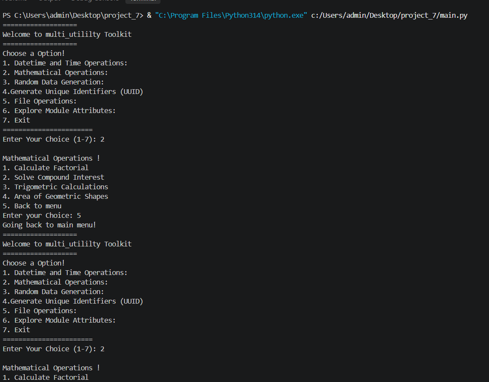

# Multi-Utility Toolkit

A menu-driven command-line application written in Python that bundles several everyday utilities into a single program. It covers date and time operations, math calculations, random data generation, UUID creation, basic file handling, and an interactive explorer for Python's standard-library modules.

The project is built entirely on Python's standard library, so there is nothing extra to install.


## Overview

The Multi-Utility Toolkit is a learning-oriented project that demonstrates how to combine several Python standard-library modules in one interactive program. Each feature lives behind a numbered menu, so the user only has to type a number to move around.

The program is designed to:

- Show practical usage of `datetime`, `time`, `math`, `random`, `uuid` and file I/O.
- Practice building nested, looping menus in the console.
- Give beginners a hands-on way to inspect what each module offers through `dir()`.

---

## Features

| Area | What you can do |
|------|-----------------|
| Datetime and Time | Work with dates and times using the `datetime` and `time` modules |
| Mathematics | Factorial, compound interest, trigonometry, area of shapes |
| Random Data | Random number, random list, password generator, OTP generator |
| UUID | Generate a universally unique identifier |
| File Operations | Create, write, read, append and search entries in text files |
| Module Explorer | List the attributes of `math`, `datetime`, `uuid`, `random` and `time` |

Highlights:

- Clear numbered menus with a "Back" option in every submenu.
- Results are printed immediately after each action.
- Submenus loop until you choose to go back, so you can run several actions in a row.
- No third-party packages needed.

---

## Requirements

- Python 3.10 or newer (developed and tested on Python 3.14)
- Any operating system that can run Python (Windows, macOS, Linux)
- A terminal or an editor with an integrated terminal (for example VS Code)
- git 
- git hub
- vs code


---

## Installation

1. Make sure Python is installed. Check your version:

   ```bash
   python --version
   ```

2. Download or clone the project folder:

   ```bash
   git clone <your-repository-url>
   cd project_7
   ```

   If you are not using Git, simply copy the project folder to your computer.

3. No dependencies need to be installed. There is no `requirements.txt` because only the standard library is used.

---

## Running the Program

From inside the project folder, run:

```bash
python main.py
```

On Windows you can also use the full interpreter path:

```powershell
& "C:\Program Files\Python314\python.exe" main.py
```

If you use VS Code, open `main.py` and press the Run button, or use the integrated terminal with the command above.

When the program starts you will see:

```
===================
Welcome to multi_utililty Toolkit
===================
```

followed by the main menu.

---

## Project Structure

```
project_7/
├── main.py        # Entry point and all menu logic
├── data.txt       # Example file created through the File Operations menu
└── README.md      # Project documentation (this file)
```

Notes:

- `data.txt` is only created if you use the File Operations menu. The name is chosen by you at runtime.
- If you later split the code into multiple files, a suggested layout is shown under [Future Improvements](#future-improvements).

---

## Main Menu

The main menu is shown every time you return from a submenu:

```
Choose a Option!
1. Datetime and Time Operations:
2. Mathematical Operations:
3. Random Data Generation:
4. Generate Unique Identifiers (UUID)
5. File Operations:
6. Explore Module Attributes:
7. Exit
=======================
Enter Your Choice (1-7):
```

| Choice | Action |
|--------|--------|
| 1 | Datetime and Time Operations |
| 2 | Mathematical Operations |
| 3 | Random Data Generation |
| 4 | Generate Unique Identifiers (UUID) |
| 5 | File Operations |
| 6 | Explore Module Attributes |
| 7 | Exit the program |

---

## Module Guide

### 1. Datetime and Time Operations

Uses the `datetime` and `time` modules to work with the current date and time and related calculations.

- Select `1` from the main menu.
- Follow the on-screen prompts in the submenu.
- Return to the main menu using the back option.

### 2. Mathematical Operations

Select `2` from the main menu to open the math submenu:

```
Mathematical Operations !
1. Calculate Factorial
2. Solve Compound Interest
3. Trigometric Calculations
4. Area of Geometric Shapes
5. Back to menu
```

| Option | Description |
|--------|-------------|
| 1. Calculate Factorial | Computes the factorial of a number (uses `math.factorial`) |
| 2. Solve Compound Interest | Calculates compound interest from principal, rate and time |
| 3. Trigonometric Calculations | Sine, cosine, tangent and related functions |
| 4. Area of Geometric Shapes | Opens a second menu for shapes |
| 5. Back to menu | Returns to the main menu |

#### Area of Geometric Shapes

```
1. Area of circle
2. Area of rectangle
```

Example (rectangle):

```
Enter your choice: 2
enter a value: 5
enter a value: 10
Area of rectangle: 50.0
```

- Circle: area = pi x r^2
- Rectangle: area = length x width

After a calculation the math menu is shown again, so you can keep going without returning to the main menu.

### 3. Random Data Generation

Select `3` from the main menu:

```
1. Random Number
2. Random list
3. create password
4. for otp
5. back to menu
```

| Option | Description | Example output |
|--------|-------------|----------------|
| Random Number | A random integer | `random number is : 91` |
| Random list | A list of random integers | `[12, 35, 78, 62, 55, 98, 65, 42, 0, 1]` |
| Create password | A random password of the length you choose | `=/m_8` (length 5) |
| OTP | A random numeric one-time password | `190284` |

Notes:

- Random values change on every run, so your output will differ from the examples.
- The password generator asks for a length, then builds a password from letters, digits and symbols.
- The OTP is a 6-digit number.
- The `random` module is not designed for cryptographic security. For production passwords or OTPs, prefer the `secrets` module.

### 4. Generate Unique Identifiers (UUID)

Select `4` from the main menu:

```
1. Create a uuid
2. back to menu
```

Example:

```
Generated uuid is : 99fccabd-6a85-4b39-aab8-a962795b9014
```

A UUID is a 128-bit identifier that is practically guaranteed to be unique. It is commonly used for database keys, session IDs and file names.

### 5. File Operations

Select `5` from the main menu:

```
1. Create a New File
2. Write to a File
3. Read from a File
4. Append to a File
5. Update to a File
6. Back to Main Menu
```

| Option | What it does |
|--------|--------------|
| 1. Create a New File | Asks for a file name (for example `example.txt`) and creates an empty file |
| 2. Write to a File | Asks for a file name and an entry, then writes the entry to the file |
| 3. Read from a File | Asks for a file name and prints the full content |
| 4. Append to a File | Adds a new entry to the end of an existing file |
| 5. Update to a File | Asks for a file name and a keyword, then shows the entries that match |
| 6. Back to Main Menu | Returns to the main menu |

Typical workflow:

1. Create `data.txt`.
2. Write the first entry.
3. Append more entries.
4. Read the file to see everything.
5. Use the keyword search to find a specific entry.

Example:

```
Enter a file Name (example.txt): data.txt
file succesfully created
Enter a file name: data.txt
Enter a entry: harshit
Message added succefully
Enter a File Name: data.txt
Enter a Entry: hurbada
Enter a file Name: data.txt
File Content :
harshit
hurbada
```

Keyword search:

```
Enter a File Name: data.txt
Enter a keyword for see entry: har
harshit
```

Important: "Write to a File" typically overwrites existing content, while "Append to a File" keeps it and adds to the end. Use append when you want to keep earlier entries.

### 6. Explore Module Attributes

Select `6` from the main menu. This tool prints the attributes of a module using Python's `dir()` function, which is a quick way to discover what a module can do.

```
1. math module
2. Date and Time Module
3. UUID's Module
4. Random Module
5. Time Module
6. Back to main menu
```

| Option | Shows attributes of |
|--------|---------------------|
| 1 | `math` (for example `sqrt`, `factorial`, `pi`, `sin`, `cos`, `gcd`) |
| 2 | `datetime` (for example `now`, `today`, `strftime`, `isoformat`, `timestamp`) |
| 3 | `uuid` |
| 4 | `random` (for example `randint`, `choice`, `shuffle`, `sample`, `seed`) |
| 5 | `time` (for example `time`, `sleep`, `strftime`, `localtime`, `perf_counter`) |

Tip: once you spot an interesting name, use `help(math.comb)` in a Python shell to read its documentation.

### 7. Exit

Select `7` to close the program. It prints:

```
Thank you for using Multi-Utility Toolkit!
```

---

## Sample Session

A short walkthrough of a typical run:

```
Enter Your Choice (1-7): 2
Enter your Choice: 4
1. Area of circle
2. Area of rectangle
Enter your choice: 2
enter a value: 5
enter a value: 10
Area of rectangle: 50.0
Enter your Choice: 5
Going back to main menu!

Enter Your Choice (1-7): 3
Enter a chocie: 1
random number is : 91
Enter a chocie: 5
Going back to main menu!

Enter Your Choice (1-7): 4
Enter a chocie: 1
Generated uuid is : 99fccabd-6a85-4b39-aab8-a962795b9014
Enter a chocie: 2
Going back to main menu!

Enter Your Choice (1-7): 7
Thank you for using Multi-Utility Toolkit!
```

---

## Standard Library Modules Used

| Module | Purpose in this project |
|--------|-------------------------|
| `datetime` | Dates, times and formatting |
| `time` | Time values, delays and clocks |
| `math` | Factorial, trigonometry, pi, area formulas |
| `random` | Random numbers, lists, passwords and OTPs |
| `uuid` | Generating unique identifiers |
| Built-in file I/O (`open`) | Creating, writing, reading and appending files |

---

## How the Menu System Works

Every feature follows the same simple pattern:

1. Print the menu.
2. Read the user's choice with `input()`.
3. Run the matching action.
4. Repeat until the user selects the "Back" option.

In pseudocode:

```python
while True:
    show_menu()
    choice = input("Enter your choice: ")

    if choice == "1":
        do_first_thing()
    elif choice == "2":
        do_second_thing()
    elif choice == "5":
        print("Going back to main menu!")
        break
    else:
        print("Invalid choice, try again.")
```

The main menu uses the same loop, and each submenu is its own inner loop. This keeps the code organized and makes it easy to add a new option: add one more menu line and one more branch.

---

## Input Handling and Error Cases

Things to keep in mind when using the toolkit:

- Menu choices must be numbers shown in the menu.
- Numeric prompts (areas, factorial, password length) expect numbers. Typing letters will cause an error unless the program validates the input.
- When reading or appending, the file name must exist. Create it first from the File Operations menu.
- File names are relative to the folder where you launched the program.
- Keyword search is case-sensitive unless the code lowercases both sides.


---

## project structure
```

│── package/
│   ├── explore_modules.py
│   ├── file_utilities.py
│   ├── __init__.py
│   └── math_utilities.py
│
├── main.py
├── output.png
└── README.md
  ```

---

## output



## Author
 ** Harshit Hurbada**
